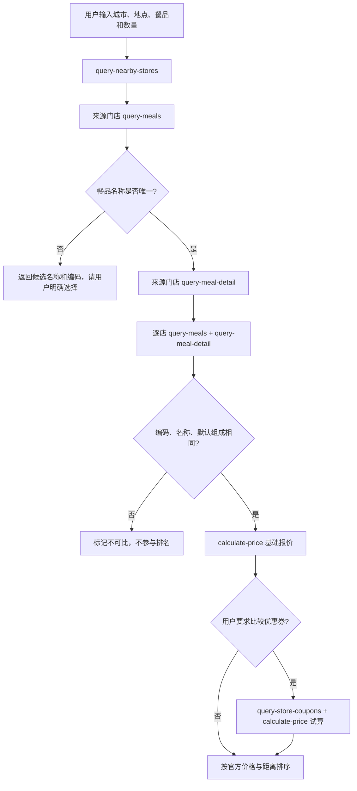

# 麦当劳 MCP 集成说明

## Server 与身份验证

- 官方 Server：`https://mcp.mcd.cn`
- 传输：Streamable HTTP
- 授权：`Authorization: Bearer <MCD_MCP_TOKEN>`，只从进程环境变量读取
- 客户端：官方 TypeScript MCP SDK `@modelcontextprotocol/client`
- 本项目对外：本地 stdio MCP Server，使用 `@modelcontextprotocol/server`

真实 Token 不保存在源码、示例配置、日志或测试中。项目不会将 Token 放到 MCP 工具结果里。

## 实际使用的官方工具

| Tool | 调用时机 | 业务价值 |
| --- | --- | --- |
| `query-nearby-stores` | 根据城市、地点关键词和取餐方式搜索门店 | 确定可比较的营业门店与官方距离 |
| `query-meals` | 获取来源门店和各候选门店当前菜单 | 证明餐品在该店实际可售，核对编码和名称 |
| `query-meal-detail` | 获取每件餐品的默认套餐组成 | 避免把默认配餐不同的套餐当成同一餐 |
| `calculate-price` | 对每家店的相同购物篮核价 | 获取可比较的官方应付金额，而非仅使用菜单标价 |
| `query-store-coupons` | 用户选择比较优惠券时 | 取得门店当前可用券，再通过 `calculate-price` 试算 |

所有调用均为真实官方 MCP Tool 调用。`doctor` 使用 `tools/list` 检查这些 Tool 是否可用。

## 典型调用流程

## 关键数据处理

1. `query-meals` 的餐品详情在 `data.meals` 字典中，以餐品编码为键；分类列表只用于展示分类，不能作为价格来源。
2. `calculate-price` 的 `data.price` 是整数“分”，例如 `2550` 表示 `¥25.50`。项目对金额做整数校验后再换算。
3. 核价返回的 `productList` 必须与请求的编码和数量完全一致，否则该门店标为 `unverified`。
4. 有歧义的名称不会自动选第一个结果；用户需用精确名称或编码重新查询。
5. 逐店错误不会中断其他门店的比较，而是把该店标记为 `unverified` 并说明原因。
6. 优惠券试算只接受对同一购物篮成功核价且金额低于基础报价的结果，最多试算 8 个券与餐品组合/店；达到上限则显示 `partial`。

## 范围与业务价值

核心场景是“同一餐去哪家店买”，解决顾客在附近门店之间无法直接比较同款可售状态和官方实付价格的问题。输出同时保留最低价和最近门店，便于用户自行权衡。项目不替用户下单，也不推断官方没有提供的排队时间、路线耗时或库存信息。
