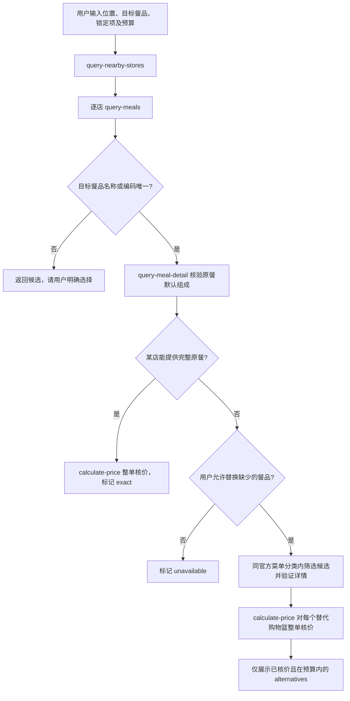

# 麦当劳 MCP 集成说明

## 官方 Server

- 地址：`https://mcp.mcd.cn`
- 传输：Streamable HTTP
- 鉴权：从进程环境变量 `MCD_MCP_TOKEN` 读取 Token，以 Bearer 请求头发送
- 本项目对外：stdio MCP Server，提供 `search_meals` 与 `plan_meal_alternatives`

项目通过官方 TypeScript MCP SDK 连接远端 Server。真实 Token 不进入源码、配置示例、日志或工具输出。

## 实际调用的官方工具

| Tool | 用途 | 业务价值 |
| --- | --- | --- |
| `query-nearby-stores` | 按城市、地点和取餐方式找当前营业门店 | 确定可查询门店和官方距离 |
| `query-meals` | 读取各门店当前在售菜单 | 判断目标餐品是否列在当前菜单，寻找候选 |
| `query-meal-detail` | 检查单品或套餐默认组成 | 区分原餐与默认组成不同的方案，验证候选餐品 |
| `calculate-price` | 对完整购物篮核价 | 只展示官方确认餐品及数量一致的整单金额 |

`doctor` 还通过 MCP `tools/list` 检查这些工具是否存在。

## 调用流程

## 处理规则

1. 从所有候选门店的 `data.meals` 解析目标商品。名称有多个匹配时要求用户指定编码；所有门店均无该餐品时不猜测它的类别。
2. 原餐必须具备相同的餐品编码、名称和默认套餐组合。若默认组合不同，输出变化内容，按备选方案处理。
3. 自动替代候选必须出现在目标门店当前菜单、与原餐共享足够明确的官方菜单分类，并通过 `query-meal-detail` 验证。宽泛的“小食甜品/其他”等分类不用于自动替代；用户可用 `replacementQueries` 显式指定跨分类备选，这些餐品仍须通过官方菜单与详情核验。
4. 使用 `calculate-price` 的整数分单位 `data.price` 生成元单位金额，并核对返回的 `productList` 与请求购物篮的编码及数量完全一致。
5. 用户可将餐品设为不可替换。可选预算按官方整单金额过滤；超预算时返回已核实的最低报价。
6. 一家门店的菜单或核价失败不影响其他门店，失败门店和原因单独呈现。候选组合试算次数有上限，不声称穷举所有可能方案。

## 业务价值与边界

作品解决“原餐在某店当前菜单中找不到，下一步怎么办”的问题：先找仍可购买原餐的门店，再提供用户可自行确认的备选餐，并给出官方整单金额。菜单缺席不代表实时库存不足；菜单分类相同也不代表口味、成分、营养或过敏原相同。项目不调用下单、领券或取消订单工具。
